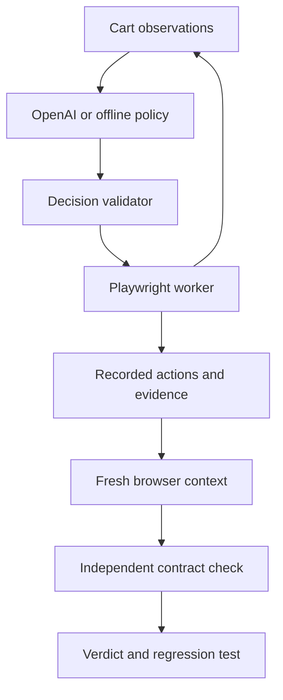

# BreakPoint

**Browser testing with evidence you can replay.**

BreakPoint separates exploration from verification: a policy chooses browser actions, a Playwright worker executes them, and a fresh browser context replays the recorded sequence against an independent contract. A model's claim alone cannot confirm a bug.

Built by **Vanshi Patel** with Python, Playwright, JavaScript, and an OpenAI Responses API adapter.

> **Project status:** working prototype for one controlled shopping-cart fixture. Offline browser runs and mocked provider tests are verified. Live OpenAI execution still needs validation with your API account. This is not a general-purpose website tester or a production service.

## What you can demonstrate

- Observe → decide → act with validated button actions.
- Fresh-context replay without additional model calls.
- Before/after screenshots, browser traces, console logs, and structured reports.
- An executable regression script that fails on the seeded bug and passes on its fixed control.
- Explicit `confirmed`, `passed`, `not_reproduced`, `inconclusive`, and `runner_error` outcomes.
- A local report viewer for your own runs, plus clearly labeled recorded examples.

## Run in five minutes

Requires Python 3.11+, Node 20+ for JavaScript tests, and Git. Run all commands from the repository root.

```bash
python3 -m venv .venv
source .venv/bin/activate
pip install -r worker/requirements.txt
python -m playwright install chromium
python -m worker.run --provider offline --fixture-directory dist
```

On Windows PowerShell, activate with `.venv\Scripts\Activate.ps1`. On Linux, missing browser system dependencies can be installed with `python -m playwright install --with-deps chromium`.

The final output gives a `report` path under `artifacts/`. Offline mode requires no API key. It is a deterministic mock policy, not AI.

## Use your API

Copy `.env.example` to `.env`, then edit `.env` privately:

```bash
cp .env.example .env
```

Set `OPENAI_API_KEY` and `OPENAI_MODEL`. Select a model your account can access that supports Responses structured outputs. The worker reads these two values automatically; existing environment variables take precedence. The `.env` parser accepts literal `KEY=value` lines, optional matching quotes, and full-line comments. It does not execute shell expressions.

```bash
python -m worker.run --provider openai --fixture-directory dist --mode buggy --max-steps 8 --timeout 60
python -m worker.run --provider openai --fixture-directory dist --mode fixed --max-steps 8 --timeout 60
```

These make real API requests and may incur charges. No key belongs in source code, GitHub, screenshots, or recordings. Missing credentials do not trigger a mock fallback. Never use live credentials in public CI.

## View and record your run

Replace the example path with the exact path printed by your command:

```bash
python -m worker.export artifacts/YOUR_RUN_ID/report.json
python3 -m http.server 8000 --bind 127.0.0.1 --directory dist
```

Open **http://localhost:8000/report.html**. The viewer reads the exported report, displays whether it came from OpenAI or a mock, and links to its evidence. `dist/live-run/` is ignored by Git. The viewer is a static display, not a remote worker or a live stream.

See [the three-minute Loom walkthrough](docs/DEMO.md) and [GitHub publishing guide](docs/PUBLISH.md).

## Architecture



The policy receives only quantity, displayed total, parsed cents, enabled buttons, and completed action history. It does not receive fixture mode, source code, diagnostic UI, screenshots, or verifier results. Allowed operations are clicks on three named buttons and `stop`. The worker stops at the first contract-failure candidate and replays successfully executed actions independently.

The current contract is deliberately narrow: **a zero-item cart must total $0.00**. The buggy fixture retains $24; the control fixes it. Passing this contract does not establish that the app is bug-free.

## Tests

```bash
python -m unittest discover -s tests -p 'test_*.py' -v
npm test
python -m worker.verify --fixture-directory dist
python -m worker.verify_policy
```

The acceptance commands launch real Chromium against locally routed fixture files. They check matching failures, clean controls, bounded exploration, evidence files, replay isolation, and exported regression scripts. The buggy regression must fail its assertion; the fixed regression must pass. The GitHub Actions workflow runs offline only.

## Artifacts and limits

| Artifact | Purpose |
| --- | --- |
| `report.json` | Verdict, source, model/usage when present, timestamps, observations |
| `actions.json` | Replayable executed actions |
| `exploration/`, `replay/` | Screenshots, trace ZIP, events and console logs |
| `regression.py` | Independent assertion when applicable |

Inspect a trace with `playwright show-trace artifacts/YOUR_RUN_ID/replay/trace.zip`.

Default limits: eight policy decisions, at most twelve; 1,200 output tokens per API request; 12-second HTTP timeout; configurable phase timeout; no retries. These are not a dollar spending cap. Interrupted requests can have incomplete usage accounting. Browser startup and cleanup sit outside the phase timeout.

HTTP mode supports local fixture origins only. The recorded acceptance runs use `--fixture-directory dist`: browser request routing serves the local HTML/JS without a web server. This is real browser execution, but it does not test network/server behavior. The worker is not a hardened sandbox for arbitrary websites.

## Roadmap

- Validate live model runs and publish reproducible results.
- Add multiple hidden seeded bugs and clean controls.
- Compare discovery/replay rates, false positives, latency, and cost against scripted baselines.
- Add a run coordinator and dashboard backed by real runs.

## Attribution and license

Developed with AI coding assistance; project design, testing, and review remain the author's responsibility. Third-party dependencies retain their licenses. A redistribution license for this project's source has not yet been selected.
